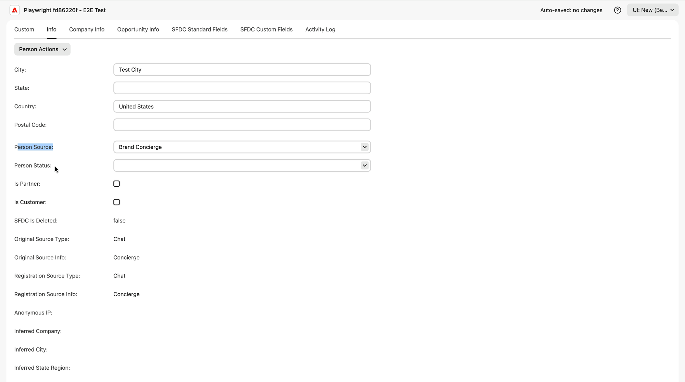

# Marketo Engage中的Brand Concierge資料 {#marketo-activities}

當[!DNL Adobe Marketo Engage]連線時，每個填寫表單、預約會議或開始即時交談的訪客都會在[!DNL Marketo]中成為個人記錄，而他們的接待參與會以原生活動型別的形式寫入該記錄。 這表示您可以根據門房行為建置智慧列示和智慧行銷活動，其方式與您在任何其他[!DNL Marketo]活動上建置的方式完全相同。

>[!NOTE]
>
>Live Chat和會議預約本身不需要[!DNL Marketo Engage]。 若沒有它，此頁面上描述的資料會保留在[!DNL Adobe Marketo Qualifier]中。 檢視[即時聊天和會議預約概述](overview.md#prerequisites)。

## 潛在客戶建立和來源歸因 {#lead-creation}

透過禮賓處建立的人會被標籤，因此您可以隨時分辨其來源。

| 欄位 | 值 |
| --- | --- |
| **[!UICONTROL 人員Source]** | `Brand Concierge` |
| **[!UICONTROL 原始Source型別]** | `Chat` |
| **[!UICONTROL 原始Source資訊]** | `Concierge` |
| **[!UICONTROL 註冊Source型別]** | `Chat` |
| **[!UICONTROL 註冊Source資訊]** | `Concierge` |

{width="800" zoomable="yes"}

## 活動類型 {#activity-types}

三種原生活動型別會推送至人員記錄。 這三個都可用作觸發器和篩選器。

{width="800" zoomable="yes"}

### 與禮賓部互動 {#engage-with-concierge}

當訪客與禮賓處互動時記錄。

| 屬性 | 說明 |
| --- | --- |
| 禮賓處名稱 | 訪客參與的服務人員 |
| 交談ID | 交談的識別碼。 在Composer中使用它以開啟完整成績單 |
| 頁面 URL | 參與發生的頁面 |
| 建立時間 | 建立交談的時間 |
| 持續時間 | 交談持續了多長時間 |

>[!NOTE]
>
>此活動型別上的某些屬性（包括討論的主題、摘要和語言）尚未填入。 已規劃於未來版本中推出。

### 在禮賓處排程會議 {#schedule-meeting}

已為單一預訂記錄&#x200B;**兩次**，這讓您可區分意圖和結果。

**首先，在起始時。** 訪客選取了排程會議的選項，預約表單隨即出現。 會議狀態為`Started`。

| 屬性 | 說明 |
| --- | --- |
| 會議狀態 | `Started` |
| 頁面 URL | 訪客起始預訂的頁面 |
| 服務人員ID | 訪客參與的服務人員 |
| 人員 ID | [!DNL Marketo]個人記錄 |

**然後，在預訂時。** 訪客已確認位置。 會議狀態為`Scheduled`。

| 屬性 | 說明 |
| --- | --- |
| 會議狀態 | `Scheduled` |
| 銷售代表姓名 | 與會議預約的代表 |
| 銷售代表電子郵件 | 代表的電子郵件地址 |
| 已排程為 | 會議的日期和時間 |
| 會議期間 | 已預約會議的長度 |
| 路由型別 | 解決此代表行事曆的路由 |
| 頁面 URL | 訪客預訂的頁面 |
| 服務人員ID | 訪客參與的服務人員 |
| 人員 ID | [!DNL Marketo]個人記錄 |

>[!TIP]
>
>在`Meeting Status`上建置智慧列示為`Started`，但不是`Scheduled`，以尋找已開始預訂會議並放棄該會議的所有人。 這是現成的培養或重新定位對象。

### 在禮賓處參與即時交談 {#engage-with-live-chat}

在即時聊天結束之後記錄。

| 屬性 | 說明 |
| --- | --- |
| 交談狀態 | `Ended`如果聊天被刻意關閉，`Dropped`如果訪客離開網站且聊天逾時 |
| 已通知的代理程式 | 每個收到此聊天通知的代理程式的電子郵件地址 |
| 交談分數 | 代表進行交談的0至3分評分。 檢視[為交談評分](chat-inbox.md#conversation-score) |
| 頁面 URL | 即時聊天起始的頁面 |
| 服務人員ID | 訪客參與的服務人員 |
| 工作階段ID | 即時聊天工作階段識別碼 |
| 開始時間 | 聊天開始時 |

>[!TIP]
>
>交談分數是此處的值最高屬性，因為實際與訪客交談的人會設定該分數。 將其用於銷售和CRM的潛在客戶評分、重新目標定位、個人化和移交。

## 在Smart Campaign中使用禮賓資料 {#smart-campaign}

在Smart Campaign的&#x200B;**[!UICONTROL 智慧清單]**&#x200B;中，搜尋`concierge`以檢視所有可用專案。

{width="800" zoomable="yes"}

| 類別 | 可用專案 |
| --- | --- |
| **[!UICONTROL 觸發器]** | 與門房互動、與門房進行即時交談、安排門房會議 |
| **[!UICONTROL 篩選器]** >活動歷程記錄 | 參與禮賓、參與禮賓的即時交談、在禮賓的排程會議 |
| **[!UICONTROL 篩選器]** >非活動篩選器 | 未參與禮賓、未參與禮賓的即時交談、未排程在禮賓的會議 |

將觸發器或篩選器拖曳到畫布上，然後選取&#x200B;**[!UICONTROL 新增限制]**&#x200B;以縮小範圍。

### 限制 {#constraints}

| 觸發或篩選 | 限制 |
| --- | --- |
| 與禮賓部互動 | 禮賓處名稱、頁面URL、建立時間、持續時間、活動日期 |
| 已排程的禮賓會議 | 禮賓處名稱、銷售代表名稱、會議狀態、已排程、會議持續時間、路由型別、頁面URL、活動日期 |
| 參與禮賓室中的即時交談 | 禮賓處名稱、銷售代表名稱、交談狀態、交談分數、開始時間、接受時間、結束時間、關閉者、持續時間、討論主題、頁面URL、語言、活動日期 |

## 下一步 {#next}

檢閱[監視會議和即時聊天](monitor.md)中會議和聊天的執行方式。
