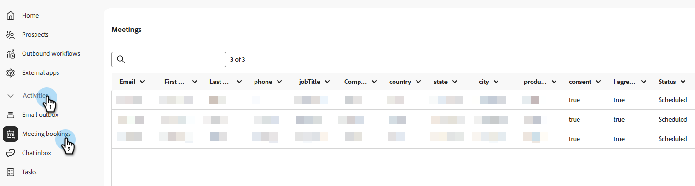

# 監視會議和即時聊天 {#monitor}

[!DNL Adobe Marketo Qualifier]保留每次移交的作業記錄：已預訂的會議、已進行的聊天，以及會議預訂的執行方式。

## 檢閱預約的會議 {#bookings}

在&#x200B;**[!UICONTROL 活動]**&#x200B;下，選取&#x200B;**[!UICONTROL 會議預訂]**&#x200B;以檢閱已預訂的會議，檢視每個會議擷取的資訊，並瞭解每個會議的排程時間。

{width="800" zoomable="yes"}

## 檢閱即時聊天 {#chats}

在「**[!UICONTROL 活動]**」下，選取「**[!UICONTROL 聊天收件匣]**」，然後開啟「**[!UICONTROL 全部]**」標籤以檢視每個交談，包括已結束的交談。 請參閱[聊天收件匣](chat-inbox.md)。

>[!NOTE]
>
>即時聊天對話會保留30天。

## 分析會議績效 {#performance}

在&#x200B;**[!UICONTROL Analytics]**&#x200B;下，選取&#x200B;**[!UICONTROL 會議效能]**，以檢視訪客要求的會議數、已預訂的會議數，以及錯過的會議數。 您也可以檢視每日、每週和每月的趨勢、已預訂的要求會議的百分比，以及哪些代表參加最多會議。

{width="800" zoomable="yes"}

## 分析Marketo Engage中的禮賓參與 {#marketo}

如需更深入的分段（包括交談分數、路由型別和放棄的會議預約），請在[!DNL Marketo Engage]中使用禮賓活動型別。 檢視Marketo Engage[&#128279;](marketo-activities.md)中的Brand Concierge資料。
