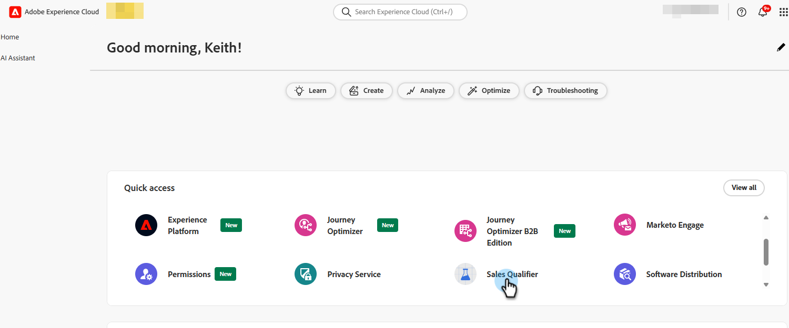

# 在Adobe Marketo Qualifier中設定代表 {#representative-setup}

在禮賓員提供會議或即時聊天之前，必須在[!DNL Adobe Marketo Qualifier]中設定至少一位代表。 每個代表在自己的設定檔中執行此動作一次。

順序為：管理員新增使用者，然後每個代表連線行事曆、寫入其確認電子郵件，並宣告他們何時可用於會議和聊天。

## 將使用者新增至組織 {#add-users}

管理員會將每位銷售代表新增為[!DNL Adobe Admin Console]中的使用者，並授予他們[!DNL Adobe Marketo Qualifier]的存取權。 如需一般程式，請參閱[新增使用者至組織](../user-and-access-management/add-a-user-to-the-org.md)和[新增使用者至角色](../user-and-access-management/add-a-user-to-the-role.md)。

代表自行完成其餘步驟。

## 連線您的行事曆 {#connect}

行事曆連線可讓禮賓人員看到實際可用性。 若沒有此專案，代表便不符合會議預約的資格。

1. 登入[Adobe Experience Cloud](https://experience.adobe.com/){target="_blank"}並選取&#x200B;**[!UICONTROL Adobe Marketo Qualifier]**。

   {width="800" zoomable="yes"}

1. 在左側面板的&#x200B;**[!UICONTROL 組態]**&#x200B;下，選取&#x200B;**[!UICONTROL 設定檔設定]**，然後開啟&#x200B;**[!UICONTROL 行事曆組態]**&#x200B;標籤。

1. 選擇您要連線的行事曆： [!DNL Microsoft Outlook]或[!DNL Google Calendar]。

   {width="600" zoomable="yes"}

1. 使用現有帳戶登入或新增帳戶，並授予要求的許可權。

   行事曆連線期間顯示的{width="600" zoomable="yes"}

1. 檢閱訪客在您預約會議時收到的確認電子郵件。

   系統會為您設定預設的主旨列和內文。 編輯其中一個，並選擇是否要在邀請中包含[!DNL Microsoft Teams]會議連結。

   {width="600" zoomable="yes"}

1. 選取「**[!UICONTROL 儲存]**」。

## 設定日曆可用性 {#calendar-availability}

連線行事曆會在您&#x200B;*忙碌*&#x200B;時通知[!DNL Adobe Marketo Qualifier]。 行事曆可用性會告訴您何時願意&#x200B;*參加*&#x200B;會議。 兩者皆會套用。

1. 在&#x200B;**[!UICONTROL 設定檔設定]**&#x200B;中，開啟&#x200B;**[!UICONTROL 行事曆可用性]**&#x200B;標籤。

   ![設定任何可用性之前的[行事曆可用性]索引標籤](../assets/meetings-availability-1.png){width="600" zoomable="yes"}

1. 設定您的會議規則。

   | 設定 | 控制內容 |
   | --- | --- |
   | 會議期間 | 已預訂的會議執行多久，以及每個所提供位置的長度 |
   | 緩衝時間 | 一個會議結束與下一個會議開始之間強制執行的間隔 |
   | 最低通知 | 訪客必須預訂的前進程度。 例如，設定4小時可防止訪客預訂在10分鐘內開始的時段 |
   | 時區 | 您的可用性時數的時區。 訪客一律會看到已轉換為自己時區的位置 |

1. 設定一週中每一天的可用時數。

   一天可以是一個連續的區塊，例如上午8:00到下午5:00，或數個區塊，例如上午8:00到下午12:00以及下午2:00到下午5:00。 將某一天留空，以便在該天不舉行會議。

   >[!NOTE]
   >
   >若要將另一個時間區塊新增到一天，請選取加號（）。

   {width="600" zoomable="yes"}

1. 選取「**[!UICONTROL 儲存]**」。

### 位置如何變成可預約位置 {#slot-logic}

只有在全部三項檢查都通過時，才向訪客提供時段：

1. 它落在您在這裡設定的可用時數內。
1. 尚未被連線行事曆上的事件佔用。 現有的9:00 AM會議會移除9:00 AM時段。
1. 它符合您的最小通知和緩衝時間。

## 設定即時聊天可用性 {#chat-availability}

即時聊天可用性與行事曆可用性分開。 代表可以聊天，但不參加會議，反之亦然。

1. 在&#x200B;**[!UICONTROL 設定檔設定]**&#x200B;中，開啟&#x200B;**[!UICONTROL 即時聊天可用性]**&#x200B;標籤。

1. 設定您的時區，然後設定您願意接收即時交談的日期和時間。 週末也可包括在內。

   {width="600" zoomable="yes"}

1. 選取「**[!UICONTROL 儲存]**」。

>[!NOTE]
>
>可用時間讓您&#x200B;*符合*&#x200B;的聊天資格。 您在聊天收件匣中的即時狀態會決定您目前是否收到這些訊息。 請參閱[聊天收件匣](chat-inbox.md)。

## 檢閱已設定的使用者 {#manage-members}

本節僅供管理員使用。 在「**[!UICONTROL 管理]**」下，選取「**[!UICONTROL 管理成員]**」，可在一個位置檢視每個代表的狀態：誰已連線行事曆、誰已設定即時聊天可用性，以及誰已中斷行事曆連線。

在啟用Composer中的整合之前使用此選項。 在這裡沒有連線行事曆的代表不符合會議預約資格，沒有即時聊天可用的代表不符合即時聊天資格。

{width="800" zoomable="yes"}

## 下一步 {#next}

設定至少一位代表後，請決定訪客與代表的相符方式。 檢視[將交談路由給代表](routing-rules.md)。
